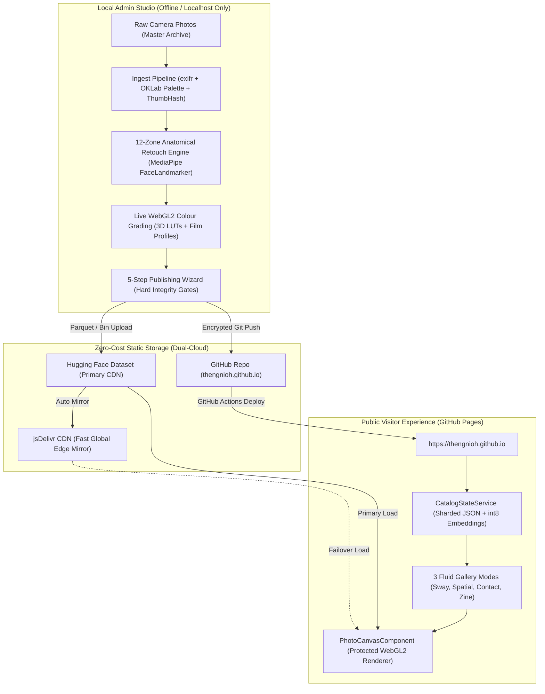

# System Architecture & Data Flow

Theng Nioh is a zero-cost-to-host personal photography portfolio and visual discovery platform featuring a local-only AI retouching & color grading admin studio, client-side AVIF/WebP ladder compression, and dual-cloud static delivery.

---

## High-Level System Architecture

---

## Data Pipeline: Step-by-Step

### 1. Ingest & Compression Pipeline
1. **Raw Files**: Photographer drops master photos into `/admin`.
2. **Metadata Normalization**: EXIF data parsed with `exifr`. GPS coordinates stripped unless explicitly marked for publication.
3. **Palette & Telemetry**: K-Means clustering in OKLab extracts 5 dominant swatches with OKLCH coordinates.
4. **Resolution Ladder**: Encodes 640px, 1280px, and 2048px variants maintaining SSIM $\ge 0.985$.
5. **Placeholder Generation**: Emits compact Base64 ThumbHash.

### 2. Retouch Engine Pipeline
1. **FaceLandmarker Detection**: MediaPipe Vision model extracts 478 3D landmarks.
2. **12 Anatomical Zones**: Generates priority-ordered masks:
   - `Lashes`, `Brows`, `Irises`, `Sclera`, `Pupils`, `Teeth`, `Lips`, `Nose`, `Cheeks`, `Forehead`, `SkinMelanin`, `Background`.
3. **Partition of Unity**: Mathematically normalizes pixel weights so $\sum w_i = 1.000 \pm 0.004$ at every pixel.
4. **$O(N)$ Guided Filtering**: Aligns mask edges to high-frequency color boundaries.
5. **Protected Zone Invariance**: Preserves $\ge 95\%$ high-frequency texture across non-skin zones.

### 3. Colour Grading & 3D LUT Pipeline
1. **Film Simulation**: Generates 3D voxels for Kodachrome 64, Portra 400, Tri-X 400, Fuji 400H, and CineStill 800T.
2. **Skin Protection Mask**: Packs single-channel alpha mask to protect delicate skin tones under extreme grading.
3. **Hardware WebGL2 Pipeline**: Samples 3D LUT with half-texel offset and native `sampler3D`.

### 4. Sharded Catalog Storage
- `public/catalog/index.json`: Root index listing monthly shards and collections.
- `public/catalog/shards/YYYY-MM.json`: Month-partitioned photo metadata arrays.
- `public/catalog/embeddings/*.bin`: Int8-quantized CLIP semantic vectors for on-device vibe search.

### 5. Protected Public Delivery
- **Zero Raw `` Tags**: All photographs render directly to WebGL2 canvas textures from memory Blobs.
- **Client-Side Deterrence**: Context menu intercept, pointer drag cancellation, canvas export deterrence.

